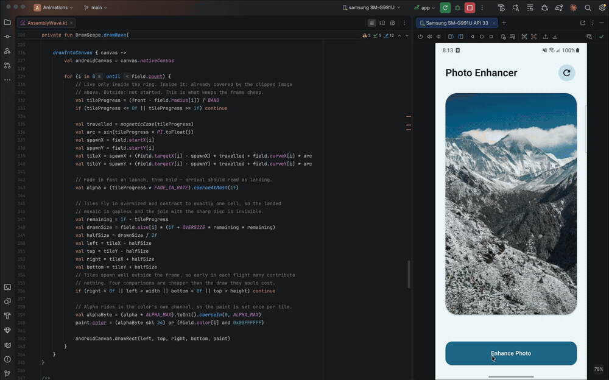

# Animations

Animation and motion experiments in Jetpack Compose — dissolves, tears, liquid, galleries
and one real cloth simulation. Each one lives in its own package with a demo screen and a
README explaining how it works.

> **This is a learning project.** It exists to explore what Compose's `Canvas`,
> `GraphicsLayer` and the Android `Canvas` underneath can be pushed to do. Nothing here is a
> published library — copy what is useful, and expect to adapt it.

Point `MainActivity` at any demo to run it.

## Gallery

|                                                                                                                                                                                                                                                                                 |                                                                                                                                                                                                                                                                           |
|---------------------------------------------------------------------------------------------------------------------------------------------------------------------------------------------------------------------------------------------------------------------------------|---------------------------------------------------------------------------------------------------------------------------------------------------------------------------------------------------------------------------------------------------------------------------|
|  **[Off The Wall](app/src/main/java/com/tsynytsyna/animations/off_the_wall)** — grab your screen, it's fabric. Pull hard and it tears off the wall.                         |  **[Wave Reassembly](app/src/main/java/com/tsynytsyna/animations/wave_reassembly)** — tiles fly in, triggered by a wave expanding from the centre.             |
|  **[Glass Shatter](app/src/main/java/com/tsynytsyna/animations/glass_shatter)** — the image breaks into glass shards and falls.                                          |  **[Gallery Disintegration](app/src/main/java/com/tsynytsyna/animations/gallery_disintegration)** — the photo blows away as particles.          |
|  **[Git Diff Swap](app/src/main/java/com/tsynytsyna/animations/git_diff)** — a change of job, told as a diff in a source file.                                            |  **[Happy Birthday](app/src/main/java/com/tsynytsyna/animations/happy_birthday)** — a cake drawn entirely on `Canvas`. Swipe to blow out the candles.   |
|  **[Rift Toggle](app/src/main/java/com/tsynytsyna/animations/rift_toggle)** — a dark/light switch that tears the screen open.                                                |  **[Polaroid Scatter](app/src/main/java/com/tsynytsyna/animations/polaroid_scatter)** — a sort/filter grid that scatters like photos on a table.            |
|  **[Cover Flow](app/src/main/java/com/tsynytsyna/animations/cover_flow)** — the classic carousel.                                                                              |  **[Fan Cards](app/src/main/java/com/tsynytsyna/animations/fan_cards)** — a three-state card stack.                                                                        |
|  **[Parallax Onboarding](app/src/main/java/com/tsynytsyna/animations/paralax_onboarding)** — layered onboarding pages that move at different depths. |                                                                                                                                                                                                                                                                           |

## Stack

Kotlin · Jetpack Compose (BOM 2024.09) · Material 3 · minSdk 26 · Glide for image loading.
No animation libraries — everything is drawn by hand.