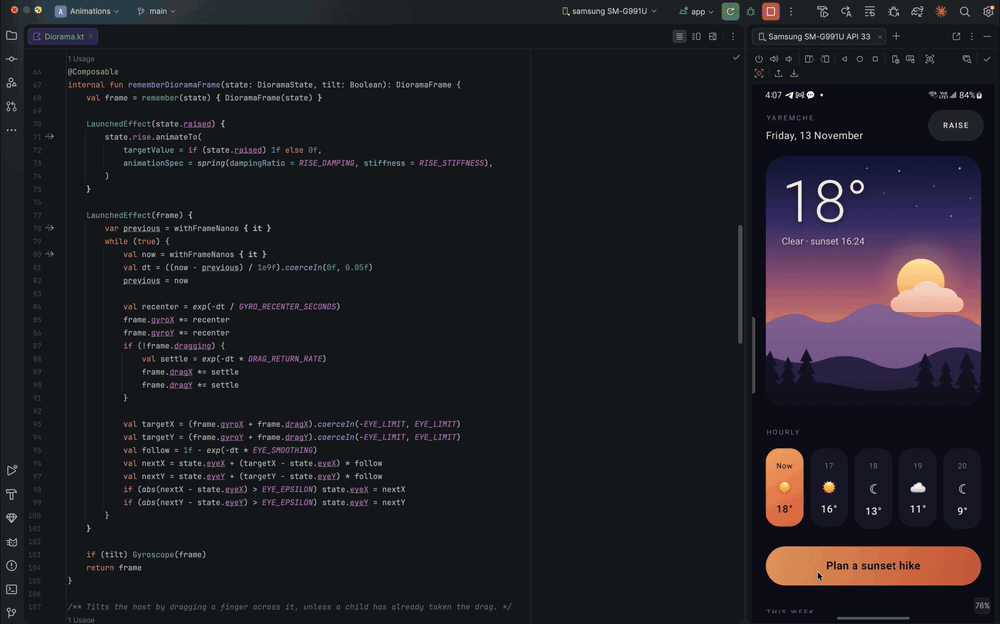

# Diorama 🏔️

Tilt the phone and the screen turns out to be a paper diorama. Every element you lift is a
sheet of card standing above the one below it. It slides over its own soft shadow and shows its
cut edge on the side you are looking from. Mark a few elements with a depth and the gyroscope
does the rest.

## Preview



*Here the tilt is driven by dragging. On a phone you just tilt it.*

---

## Usage

Lift anything with a modifier:

```kotlin
Text("Slow Tide", Modifier.diorama(depth = 28.dp))
```

Give it a `shape` to make it a solid block, with an edge and a cast shadow:

```kotlin
Box(
    Modifier
        .size(76.dp)
        .diorama(depth = 36.dp, shape = CircleShape, edge = Color(0xFF7A3418))
        .background(Accent, CircleShape)
)
```

Or wrap it, if that reads better:

```kotlin
Lifted(depth = 24.dp, shape = RoundedCornerShape(50)) {
    MyButton()
}
```

That is the whole integration. Nothing has to wrap the screen. The first lifted element turns
the gyroscope on and the last one to leave turns it off, and all of them share it.

### Optional host

Wrap the screen in `Diorama` when you also want either of these:

```kotlin
val state = rememberDioramaState()

Diorama(state, Modifier.fillMaxSize()) {
    MyScreen()          // lifted elements inside follow this host
}

state.raise()           // every lift inside rises on a spring
state.flatten()         // …and settles back flat
state.toggle()
```

- **Drag to tilt.** A finger drag on empty space tilts the scene, which is useful on emulators
  and on devices without a gyroscope. Drags that a child consumes, such as scrolling or
  sliders, still go to that child.
- **Raise / flatten.** `rise` animates every lift inside the host at once.

## Parameters

| Parameter | Default     | Effect                                                                                                                                          |
|-----------|-------------|-------------------------------------------------------------------------------------------------------------------------------------------------|
| `depth`   | —           | Height above whatever the element sits on. Sets both how far it travels and how soft and far away its shadow is                                 |
| `shape`   | `null`      | The element's visible outline. With it, the element is a solid block with an edge and a cast shadow. Without it, it only floats (good for text) |
| `edge`    | `#1E1E26`   | Colour of the cut edge. It is shaded from darker at the base to lighter at the top                                                              |

### Picking depths

Lifts nest, so a child's `depth` is measured from its parent:

```kotlin
Box(Modifier.diorama(14.dp, card)) {                      // the card: 14 dp
    Box(Modifier.diorama(4.dp, CircleShape))              // the sun: 14 + 4
    Ridge(Modifier.diorama(34.dp, RidgeShape))            // front ridge: 14 + 34
    Text("18°", Modifier.diorama(42.dp))                  // the title: 14 + 42
}
```

What reads as depth is the *difference* between neighbours. Steps of 6–10 dp between
layers look like stacked paper. 4 dp is barely visible, and past ~45 dp the top layer
starts to swim.

## Things to know before you lift something

1. **You choose what lifts.** Nothing is detected automatically. Three attempts at guessing
   "important" elements from the layout or semantics tree all looked worse than marking a
   handful by hand.
2. **Parents still clip.** A lifted element inside `clip`, `verticalScroll`,
   `horizontalScroll` or a `LazyRow` is cut at that container's bounds, together with its
   shadow and edge. Give the container some inner padding.
3. **The shape should match what you draw.** The edge and shadow are built from `shape`, not
   from pixels. A `RoundedCornerShape(12.dp)` on a card clipped to 22 dp leaves a mismatched
   rim.
4. **Material buttons have an invisible 48 dp touch area.** Lift them with
   `LocalMinimumInteractiveComponentSize provides Dp.Unspecified`, or the shadow is cast by a
   box larger than the button.
5. **Big free-form shapes cost the most.** A dozen cards or buttons is fine. Several shapes
   the width of the screen, such as the mountain ridges in the demo, are where the frame
   budget goes. See *Cost*.
6. **Android 11 and below** have no blur, so the shadow there is a plain translucent
   silhouette.

The element itself is moved, not a copy of it, so it stays live: clicks, ripples, text
fields and animations inside behave as usual.

## How it works

- **Gyroscope → eye.** The gyroscope reports rotation *speed*. Integrating it gives how far
  the phone has turned, which becomes an eye position from −0.38 to 0.38. Three adjustments
  keep that usable in a hand:
  - a dead zone, so tremor doesn't jitter the scene;
  - a slow leak back to centre (~7 s), so whatever way you hold the phone becomes "straight";
  - exponential smoothing on top.
- **One translation per element.** Each lift moves by `−eye × depth × 1.2` through
  `graphicsLayer.translationX/Y`. That is a layer property, so tilting never recomposes,
  relayouts or re-records the element. Different depths move by different amounts, and that
  difference is the depth you see.
- **The shadow stays behind.** The cast shadow is drawn *under* the element, outside its
  moving layer, offset away from a light above and to the left. As the element slides, the
  gap between it and its shadow opens and closes, which is the cue that it is floating. The
  shadow is the shape's silhouette blurred with a `RenderEffect`, rendered at a quarter size
  and scaled up.
- **The edge is a stack of rings.** Between where the element sits and where it has slid to,
  its outline is drawn every 1.5 dp, shaded from dark at the base to light at the top. That
  makes the visible side of a thick piece of card. Each tone of ring is rasterised once into
  its own texture, so per frame the edge only places textures and never strokes a path again.
- **A small contact shadow.** Simple shapes (circles and rounded rectangles) also get a short
  platform `shadowElevation`, which darkens the base where the block meets the surface.
  Free-form paths skip it, because Android renders the shadow of an arbitrary path very
  slowly.
- **Free-form shapes, once.** The demo's ridges and clouds are several paths merged with
  `Path.op(Union)` into one outline, cached per size. One outline means the edge has no
  seams where the pieces overlap.

## Cost

Measured on a Pixel 4a, `dumpsys gfxinfo`, tilting continuously:

| Screen                                                            | Janky frames |
|-------------------------------------------------------------------|--------------|
| A simpler screen: cover, two titles, play button, Material button | 0 %          |
| The weather demo above: 3 ridges, sun, cloud, 7 cards             | 1.6 %        |
| Scrolling the weather demo                                        | 0 %          |

Without a host there is no frame loop at all. Smoothing runs inside the gyroscope callback,
and while the phone is still no layer is invalidated. A `Diorama` host does run a frame loop
for as long as it is on screen, because it has to settle drags and the raise spring.
