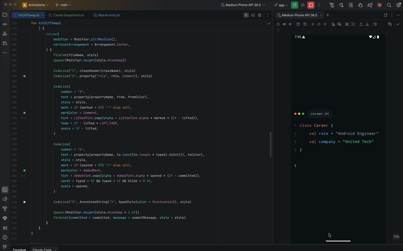

# Git Diff Swap (Jetpack Compose)

A change of employer told the way a developer would tell it — as a diff in a source file. The old
company's line is marked, the new one is typed in under it, the old line is lifted out, and the
change is committed.

Built for a "I've moved on" post: the effect is not a visual trick but a joke the audience is in
on, which is what makes it worth sharing.

---

## Preview



---

## Overview

The whole screen is an editor: window dots, a file tab, numbered lines, syntax colours from the
GitHub dark palette. The two company names carry your brand colours, which conveniently sit where
a string literal's colour would be anyway.

One deliberate departure from a real diff: **the removed line is never struck through, and there is
no red.** It gets a neutral grey wash, dims, and folds away. When the diff is about people, a red
strikethrough reads as crossing someone out of your life.

Type size is not fixed. The component measures every line it will ever draw and picks the largest
size at which the widest of them still fits the screen, so nothing is ever clipped or wrapped.

---

## How to

### 1. Drop it into a screen

The composable fills its parent and paints its own background, so give it the whole screen:

```kotlin
setContent {
    GitDiffSwap(
        from = "United Tech",
        to = "Zello",
        fromColor = Color(0xFF2FBF71),
        toColor = Color(0xFFFF7A18),
    )
}
```

That is the whole integration. It loops on its own — no state to hold, nothing to trigger.

### 2. Put your own words in it

Every string on screen is a parameter:

```kotlin
GitDiffSwap(
    from = "United Tech",
    to = "Zello",
    fromColor = Color(0xFF2FBF71),
    toColor = Color(0xFFFF7A18),
    fileName = "career.kt",
    className = "Career",
    propertyName = "company",
    role = "Android Engineer",
    commitMessage = "feat: new chapter",
)
```

Nothing is hardcoded to a career story. The same component works for anything shaped like
"this replaced that":

```kotlin
GitDiffSwap(
    from = "Sketch",
    to = "Figma",
    fromColor = Color(0xFFFDB300),
    toColor = Color(0xFFA259FF),
    fileName = "stack.kt",
    className = "Toolbox",
    propertyName = "design",
    role = "Product Designer",
    commitMessage = "chore: switch tools",
)
```

### 3. Mind the longest line

The type size is driven by the **widest** line, and the commit command counts as one. A long
message shrinks the code:

| Commit message                 | Effect                                     |
|--------------------------------|--------------------------------------------|
| `feat: new chapter`            | Code stays large — the role line rules     |
| `refactor: same me, new place` | Now the widest line; code shrinks a little |

If you want bigger type, shorten `role` — `"Android Engineer"` is usually the longest line in the
file, so `"Android Dev"` buys a couple of points of size for everything.

### 4. Recording it for a post

- The cycle is 7 s of animation plus a 1.4 s pause. One full loop is the clip.
- Start the recording on the pause, so the first frame is the untouched file — the "before" needs a
  moment to be read before anything moves.
- Portrait suits the feed, and the composition already centres itself vertically.

### 5. Tuning the timing

Every beat is a fraction of the cycle, declared at the top of `GitDiffSwap.kt`. To slow the typing
down without touching anything else, widen its range and push what follows:

```kotlin
private const val TYPE_FROM = 0.36f
private const val TYPE_TO = 0.62f    // ← raise this, then raise LIFT_* and COMMIT_* to match
```

To change the overall pace instead, leave the fractions alone and set `CYCLE_MILLIS`.

---

## Parameters

| Parameter       | Default             | Effect                                                    |
|-----------------|---------------------|-----------------------------------------------------------|
| `from`          | —                   | The value being replaced, in `fromColor`                  |
| `to`            | —                   | The value replacing it, typed out in `toColor`            |
| `fromColor`     | —                   | Brand colour of the old value                             |
| `toColor`       | —                   | Brand colour of the new value                             |
| `fileName`      | `career.kt`         | Name on the file tab                                      |
| `className`     | `Career`            | Class on line 1                                           |
| `propertyName`  | `company`           | Property the two values are assigned to                   |
| `role`          | `Android Engineer`  | Line 2. Usually the widest line, so it sets the type size |
| `commitMessage` | `feat: new chapter` | What the terminal commits                                 |

Tuning constants inside the file:

| Constant                          | Default     | Effect                                               |
|-----------------------------------|-------------|------------------------------------------------------|
| `CYCLE_MILLIS`                    | `7000`      | Length of one pass                                   |
| `PAUSE_MILLIS`                    | `1400`      | Rest between passes, with the file whole             |
| `MIN_CODE_SIZE` / `MAX_CODE_SIZE` | `10` / `22` | Bounds of the automatic type size, in sp             |
| `LIFT_FADE`                       | `0.65f`     | How much brightness the old line gives up as it goes |
| `INDENT`                          | `4`         | Indent of a property line, in characters             |

---

## How it works

One `Animatable` runs 0 → 1 over the cycle, and each beat reads its own slice of it through
`span(from, to, time)`. Nothing holds state of its own, so the animation is fully described by a
single number and can be scrubbed or restarted at any point.

| Fraction    | Beat                                                           |
|-------------|----------------------------------------------------------------|
| 0.10 – 0.20 | The old line is marked: `–` in the gutter, a grey wash         |
| 0.26 – 0.36 | A line opens below it, `+` in the gutter, green wash           |
| 0.36 – 0.62 | The new value types out, with a blinking caret                 |
| 0.68 – 0.78 | The old line dims and folds away — its height animates to zero |
| 0.82 – 0.98 | The commit command types out; the stat line lands at the end   |

Two details worth knowing:

- **Lines collapse by height, not by opacity.** `CodeLine` takes a `scale` that multiplies its
  height, so a line at 0 is gone from the layout and the ones below it close the gap.
- **The fit is measured, not estimated.** `fitCode` lays out every line at a 20 sp probe, takes the
  widest, and scales from there. An earlier version multiplied a character count by an assumed
  monospace width and got it wrong — the role line wrapped and broke the layout.

---

## The demos

| Demo              | Shows                                                       |
|-------------------|-------------------------------------------------------------|
| `GitDiffSwapDemo` | Just this effect, with placeholder brand colours            |
| `CareerSwapDemo`  | This effect and the analogue-TV one; tap anywhere to switch |

Both keep their colours as constants at the top of the file — swap those for the real brand values.

---

## Notes

- Monospace throughout, via `FontFamily.Monospace`. The auto-fit assumes nothing about the font
  beyond width scaling linearly with size, so a custom mono font can be dropped in.
- Code lines are `maxLines = 1, softWrap = false`. Clipping a line is recoverable; wrapping one
  wrecks the layout, and the auto-fit exists to make sure neither happens.
- The component has no external dependencies beyond Compose — no images, no shaders, no capture.