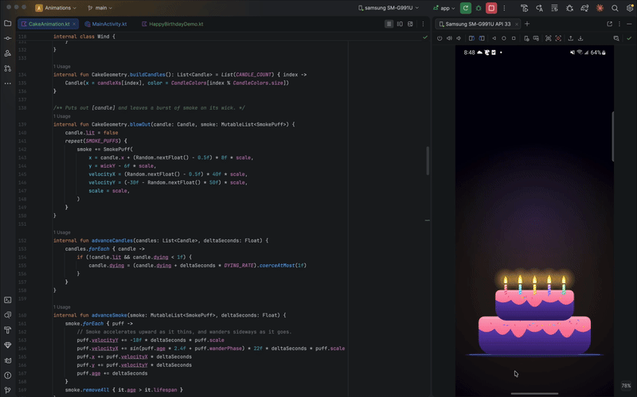

# Happy Birthday (Jetpack Compose)

A birthday scene drawn entirely on a `Canvas`. Swipe across the candles to blow them out; the
smoking wicks give up a swarm of sparks that rises, settles onto the letterforms of
**Happy Birthday** and fuses into solid lettering.

---

## Preview



---

## Overview

Two halves that meet in the middle of the screen:

- **The cake** is ordinary vector artwork — tiers, frosting, sprinkles, striped candles — with
  the flames as the only thing made of light, blended additively so they read as a source of
  light rather than a shape.
- **The greeting** is a particle system whose target positions are not authored by hand. The
  text is laid out and rasterised offscreen, its opaque pixels are sampled on a grid, and each
  sampled pixel becomes one dot. Because the dots sit on real glyph pixels, the crossfade into
  actual text at the end has nothing to give itself away with.

The wind is a shared piece of state: it bends the flames while the finger moves and, past a
threshold, puts them out.

---

## Files

| File                    | Contains                                                                        |
|-------------------------|---------------------------------------------------------------------------------|
| `HappyBirthdayDemo.kt`  | The screen: scene assembly, frame loop, the blow-out gesture, draw order        |
| `CakeAnimation.kt`      | `CakeGeometry`, `Candle`, `SmokePuff`, `Wind`, and all cake/flame/smoke drawing |
| `GreetingText.kt`       | `GreetingDot`, `Greeting`, the raster-and-sample build, and the reveal drawing  |

---

## Usage

```kotlin
HappyBirthdayDemo(Modifier)
```

The composable fills its parent and paints its own background, so it is meant to sit at the
root of a screen. It draws edge to edge, under the system bars — pair it with transparent bars
so the night sky runs to the corners:

```kotlin
enableEdgeToEdge(
    statusBarStyle = SystemBarStyle.dark(Color.TRANSPARENT),
    navigationBarStyle = SystemBarStyle.dark(Color.TRANSPARENT),
)
```

Everything is derived from the canvas size, so there is nothing to configure per device. The
scene is rebuilt whenever the size changes — a rotation re-lays out the cake and re-samples the
greeting.

---

## Parameters

**Greeting** — `GreetingText.kt`

| Parameter         | Default    | Effect                                                                          |
|-------------------|------------|---------------------------------------------------------------------------------|
| `GREETING`        | two lines  | The words. Longer text means a smaller type size and a sparser halftone         |
| `SAMPLE_STEP`     | `3`        | Sampling stride in raster px. **Quadratic** in dot count — the main cost dial   |
| `REST_RADIUS`     | `2.9f`     | Radius a landed dot settles at, against the 6px spacing the stride works out to |
| `FUSE_START`      | `0.85f`    | Where in the reveal the dots start dissolving into solid glyphs                 |
| `VERTICAL_ANCHOR` | `0.30f`    | Fraction of canvas height the greeting is centred on                            |
| `RASTER_SCALE`    | `0.5f`     | Size of the offscreen raster relative to the canvas                             |
| `Palette`         | six stops  | Gold → pink → violet → aqua ramp, sampled left to right across the width        |

**Cake** — `CakeAnimation.kt`

| Parameter             | Default | Effect                                                      |
|-----------------------|---------|-------------------------------------------------------------|
| `CANDLE_COUNT`        | `5`     | Candles, and therefore the sources the greeting flies from  |
| `CAKE_SCALE`          | `1.18f` | Overall size of cake, candles, smoke and sprinkles          |
| `BLOW_OUT_WIND`       | `240f`  | Wind speed a flame cannot survive                           |
| `WIND_PER_DRAG_PIXEL` | `3.2f`  | Wind raised per pixel of horizontal drag                    |
| `WIND_DECAY`          | `4f`    | How fast a gust dies once the finger stops                  |
| `SMOKE_PUFFS`         | `12`    | Puffs released by a wick as its flame dies                  |
| `FLAME_GAP`           | `7f`    | Gap between the candle top and the base of the flame        |

**Screen** — `HappyBirthdayDemo.kt`

| Parameter           | Default | Effect                                                                |
|---------------------|---------|-----------------------------------------------------------------------|
| `BLOW_RADIUS`       | `130f`  | How close to a candle the finger has to pass                          |
| `REVEAL_MILLIS`     | `2400`  | Length of the whole greeting reveal                                   |
| `MAX_FRAME_SECONDS` | `0.05f` | Longest simulation step, so a dropped frame cannot teleport particles |

---

## How it works

1. **Two layouts, one set of proportions.** `buildGreeting` measures the text twice — once at
   half size for the raster, once at full size for the final glyphs. Every dimension is a
   fraction of the layout width (`width / 5.0f` for the type size), so both land on exactly the
   same pixels and the crossfade is invisible.
2. **Sampling.** The half-size raster is drawn into an `ImageBitmap`, read once via
   `toPixelMap()`, and scanned on a grid — only across the band the text occupies. Pixels above
   55% alpha become dots, coloured by their horizontal position in the palette.
3. **Flight.** Each dot is born on a random wick, with a delay staggered left to right so the
   greeting wipes on instead of popping. It travels on an `EaseOutCubic` with a sideways bulge
   that peaks mid-flight, so the swarm never moves in straight lines.
4. **Landing.** Dots fly *smaller* than they land, and converge on one uniform `REST_RADIUS`
   with a uniform brightness. Both matter: varied sizes at rest read as speckle, and dots that
   shrink on arrival make the finished word dimmer than the flight. The in-flight halo fades to
   nothing by the time a dot lands, for the same reason.
5. **Fusing.** Over the last 15% of the reveal the dots fade out and the real glyphs fade in.
   Once the crossfade is complete the dot pass is skipped entirely.
6. **Blowing out.** A drag feeds `Wind.gust()`; past `BLOW_OUT_WIND` any lit candle within
   `BLOW_RADIUS` of the finger is extinguished, leaving a burst of smoke on its wick. The gust
   decays exponentially — `speed *= exp(-WIND_DECAY * dt)` — so it dies at the same rate
   whatever the frame length. When the last flame goes out, the reveal starts.
7. **Stopping.** Once the candles are out, the smoke is gone and the reveal has finished, the
   frame loop shuts itself down rather than redrawing an unchanging picture at 60fps forever.

---

## Notes

- Dot count is the cost of the whole screen: `SAMPLE_STEP` is quadratic in it, and at the
  default the swarm is a few thousand circles per frame. Raise the stride before anything else.
- `buildGreeting` rasterises and samples on the calling thread during composition. It runs once
  per size, but it is the one place that could stutter on entry; move it to a background
  dispatcher if that shows up in a trace.
- The cake is completely static and still redrawn every frame. Caching it into an `ImageBitmap`
  is the next optimisation available, though it is small next to the dots.
- The effect does not clip to its bounds and paints its own background; it expects to own the
  screen.