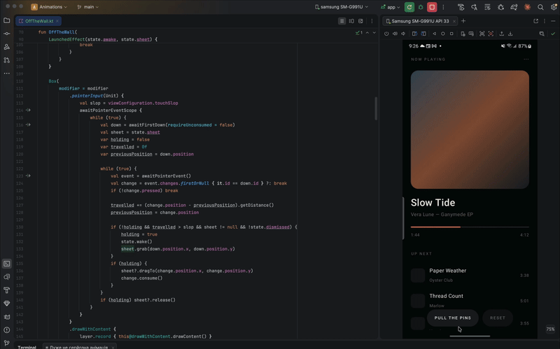

# Off The Wall 🧵

Your screen is a sheet of fabric nailed to the wall. Drag it and it sags, folds and catches
the light. Pull hard enough and the nails tear out one by one — the screen falls off and
whatever was behind it is simply there.

Real mass-spring cloth: ~1000 nodes, ~5900 springs, solved every frame. Nobody authored the
wrinkles.

## Preview



---

## Usage

Wrap anything.

```kotlin
val state = rememberOffTheWallState()

OffTheWall(state, Modifier.fillMaxSize()) {
    MyScreen()
}
```

That is the whole integration. Until the first drag it is an ordinary composable — live,
interactive, nothing simulated, not even a frame callback. The solver starts on the first
drag and stops again on `reset()`.

### Dismissing a screen with it

```kotlin
OffTheWall(
    state = state,
    modifier = Modifier.fillMaxSize(),
    onDismissed = { navController.popBackStack() },
) {
    DetailScreen(item)
}
```

`onDismissed` fires once, when the last of the sheet has fallen past the bottom edge.

### Driving it from code

```kotlin
state.drop()     // pull every nail at once
state.reset()    // nail it back up, flat, solver off, content interactive again

state.awake      // solver running
state.pinned     // any nail still holding
state.dismissed  // sheet has left the screen
```

## Parameters

| Parameter     | Default | Effect                                                                                |
|---------------|---------|---------------------------------------------------------------------------------------|
| `columns`     | `22`    | Nodes across; rows follow to keep cells square. Past ~30 buys detail nobody sees      |
| `wind`        | `1f`    | Ambient breeze multiplier. `0f` holds it perfectly still                              |
| `tearAt`      | `1.45f` | How far a nailed spring may stretch before that nail pulls out. `0f` disables tearing |
| `onDismissed` | `{}`    | Fired once, when the sheet clears the bottom edge                                     |

### Picking `tearAt`

Measured peak tension on a nail against how far the finger pulls, on a 2160 px screen:

| Pull   | % of screen | Stretch |
|--------|-------------|---------|
| 150 px | 7 %         | 1.20×   |
| 300 px | 14 %        | 1.31×   |
| 500 px | 23 %        | 1.50×   |
| 800 px | 37 %        | 1.81×   |

At the default `1.45f` a casual drag never tears; a deliberate quarter-screen pull pops the
first nail, the rest cascade in ~0.3 s, and the sheet clears the screen 0.7–1.2 s later.
Below `1.2f` the screen comes off by accident. Above `1.6f` nobody gets it off.

## Three things to know before you wrap something

1. **The texture is captured once.** While asleep the content is live and updates normally.
   From the first drag the pixels are frozen — a running timer or a late-loading image will
   stop on that frame.
2. **Scrolling inside conflicts.** Consumed events are not checked, so a drag over a
   `LazyColumn` will scroll the list *and* grab the cloth. Decide who wins before using it
   over scrollable content.
3. **It hangs from the top edge.** Pinning any other edge is a code change, not a parameter.

Taps are safe — only movement past the touch slop takes hold, so buttons inside still work.

## How it works

- **Verlet integration.** A node stores where it is and where it was last frame; the gap
  between them *is* its velocity. Move a node and its momentum follows for free, which is
  why constraints can just reposition things.
- **Three springs per neighbour.** Structural along the weave, shear across the diagonals,
  bend two nodes out. Their relative stiffness is the fabric: stiff bend gives paper, slack
  gives silk.
- **Gauss-Seidel relaxation.** Five sweeps per frame, each pulling every over-stretched
  spring back toward its rest length. Fixing one spring disturbs its neighbour, so you go
  around several times — like tightening wheel bolts in a star pattern.
- **Nails are not a special case.** A pinned node is one with an inverse mass of zero: it
  pulls its neighbours and never moves. Your finger is the same thing, temporarily.
- **One draw call.** `drawBitmapMesh` demands a uniform source grid, which is what makes it
  useless for most warps — but a woven sheet is a uniform grid by definition, so the whole
  screen is one hardware-accelerated draw with the captured UI as the texture.
- **Lighting is a second bitmap.** Each node's normal becomes one pixel — white facing the
  lamp, black facing away — in a tiny image drawn through the *same* mesh. Bilinear
  filtering turns those pixels into smooth shading across the screen. Gouraud shading for
  the price of one extra draw.
- **Tearing is tension, not distance.** Each frame every nail is asked how far the spring
  below it has stretched. Over the limit and it lets go; its share of the load moves to its
  neighbours, which usually exceed the limit a frame or two later. The sheet unzips itself.

## Cost

No per-pixel work and no particles. ~29 000 spring solves per frame in flat `FloatArray`s,
two `drawBitmapMesh` calls, and a 23×45 bitmap upload for the lighting. The breeze is
separable, so it costs ~68 trig calls per frame instead of ~2000.

Nothing runs at all until the first drag.