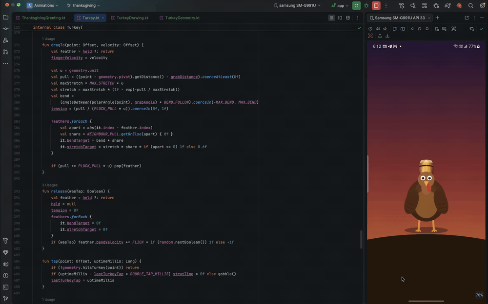

# Thanksgiving 🦃

A turkey at dusk, drawn entirely on a `Canvas`. Swipe up and it fans its tail; every feather
names something to be thankful for. Grab a feather and pull it out: it stretches, pops off with
an *ouch!*, bursts into a puff of down and sends its word floating up. Pull them all and a swarm
of dots rises from the empty tail and settles into **Happy Thanksgiving**.

## Preview



---

## Overview

- **The tail** is nine feathers on springs. It opens centre first and eases a hair past its mark
  before settling; while open, the whole fan breathes in and out together.
- **Pulling** is a rubber band: easy at first, ever harder. The held feather bends after the
  finger and drags its neighbours along, and the turkey squints harder the further it goes. Let
  go early and everything snaps back with a boing; pull far enough and the feather pops out.
- **The pop** is over in about a second — the feather shoots off spinning and shrinking, bursts
  into a puff of down, and its word drifts up.
- **The greeting** is the same technique as Happy Birthday: the text is rasterised offscreen,
  its pixels are sampled, and each sample becomes a dot that flies to its place in a letter
  before the dots fuse into real lettering.
- **The turkey** has a little life of its own. Tap it and it gobbles; double-tap it and it
  struts — puffs up, sends a slow ripple across its tail and steps from foot to foot. Its eyes
  follow the feather being pulled, then the one flying off.

---

## Files

| File                      | Contains                                                                       |
|---------------------------|--------------------------------------------------------------------------------|
| `ThanksgivingDemo.kt`     | The screen: scene assembly, frame loop, the gesture, draw order                |
| `Turkey.kt`               | `Turkey` state: feather springs, pulling, pop and puff, strut, gobble, eyes    |
| `TurkeyGeometry.kt`       | `TurkeyGeometry` proportions, feather outlines and gradients, colours          |
| `FeatherDrawing.kt`       | `FeatherStyle`, feather and covert sprites, drawing the tail and the down      |
| `TurkeyDrawing.kt`        | The hill, body, head, eyes and floating words                                  |
| `ThanksgivingGreeting.kt` | `GreetingDot`, `Greeting`, the raster-and-sample build, and the reveal drawing |

---

## Usage

```kotlin
ThanksgivingDemo(Modifier)
```

The composable fills its parent and paints its own sky, so it is meant to sit at the root of a
screen. It draws edge to edge, under the system bars — pair it with transparent bars:

```kotlin
enableEdgeToEdge(
    statusBarStyle = SystemBarStyle.dark(Color.TRANSPARENT),
    navigationBarStyle = SystemBarStyle.dark(Color.TRANSPARENT),
)
```

Everything is sized from the canvas, so there is nothing to configure per device.

| Gesture                      | What happens                                     |
|------------------------------|--------------------------------------------------|
| Swipe up / down              | Fan the tail open / fold it; after the last feather, swipe up to grow them back |
| Drag a feather               | Pull it out — let go early and it springs back   |
| Tap a feather                | Flick it, to hint that it can be pulled          |
| Tap the turkey               | Gobble                                           |
| Double-tap the turkey        | Strut                                            |

---

## Parameters

**Tail** — `Turkey.kt`

| Parameter           | Default            | Effect                                                                    |
|---------------------|--------------------|---------------------------------------------------------------------------|
| `Thanks`            | nine words         | One feather per word, left to right                                       |
| `FAN_DEGREES`       | `160f`             | Spread of the open fan                                                    |
| `FOLDED_LENGTH`     | `0.62f`            | Length of a folded feather against an open one                            |
| `SPRING_STIFFNESS`  | `70f`              | Fan spring; with `SPRING_DAMPING = 13.4f` a damping ratio of about 0.8    |
| `OPEN_STAGGER`      | `0.05f`            | Seconds between neighbouring feathers starting to open                    |
| `BREATH`            | `0.012f`           | How much the open fan widens and narrows while idle                       |
| `SWIPE_DP`          | `60f`              | Vertical drag that counts as a swipe                                      |

**Pulling** — `Turkey.kt`

| Parameter           | Default            | Effect                                                                    |
|---------------------|--------------------|---------------------------------------------------------------------------|
| `PLUCK_PULL`        | `0.3f`             | How far to pull, as a fraction of a feather's length, before it pops      |
| `MAX_STRETCH`       | `0.16f`            | The most a feather stretches out of the tail                              |
| `BEND_FOLLOW`       | `0.55f`            | How much a held feather bends after the finger moving sideways            |
| `NEIGHBOUR_PULL`    | `1, 0.35, 0.12`    | Share of the pull taken by the feather itself, one away, two away         |
| `SNAP_STIFFNESS`    | `260f`             | The bouncy spring feathers snap back on (`SNAP_DAMPING = 11f`)            |
| `POP_SECONDS`       | `0.32f`            | Flight before a plucked feather bursts into down                          |
| `DOWN_WISPS`        | `26`               | Wisps in the puff of down                                                 |

**Greeting** — `ThanksgivingGreeting.kt`

| Parameter           | Default            | Effect                                                                    |
|---------------------|--------------------|---------------------------------------------------------------------------|
| `GREETING`          | two lines          | The words                                                                 |
| `SAMPLE_STEP`       | `3`                | Sampling stride in raster px. **Quadratic** in dot count                  |
| `REST_RADIUS`       | `2.9f`             | Radius a landed dot settles at                                            |
| `FUSE_START`        | `0.85f`            | Where in the reveal the dots start dissolving into solid lettering        |
| `VERTICAL_ANCHOR`   | `0.22f`            | Fraction of the height the greeting is centred on                         |
| `Palette`           | six stops          | Cream → gold → orange and back, the feathers' colours                     |

---

## How it works

1. **One gesture.** A single `awaitEachGesture` loop decides what a touch is the moment it
   lands: on a feather it holds that feather; anywhere else a vertical swipe folds or fans the
   tail, and a tap is a gobble — or a strut if it is the second tap within 350 ms.
2. **Three springs per feather.** One for how open it is, one for its sideways bend, one for how
   far it is drawn out of the tail. A held feather follows the finger on a stiff spring; once let
   go, every feather snaps back on a bouncier one. All of them are stepped four times a frame, so
   a long frame never makes them jump. Only the angle follows the fan spring's overshoot — the
   length never overshoots, so feathers grow instead of stretching and shrinking.
3. **The pull.** The pull is how far the finger has moved from the tail's pivot since it
   grabbed, mapped through `max · (1 − e^(−pull / max))`, so the feather gives easily at first
   and ever less after. Neighbours take a share of the bend and stretch through
   `NEIGHBOUR_PULL`. At `PLUCK_PULL` the feather pops.
4. **Feathers as sprites.** Each feather has a blurred shadow, a light-to-dark sheen, fine barbs
   and soft tip markings, with a second row of short bronze covert feathers over the base of the
   tail. A blur is far too slow to repeat every frame, so each feather — shadow and all — is
   painted once into an `ImageBitmap`, and a frame only draws those bitmaps rotated and scaled.
   The words are drawn live, so they can fade in as the fan opens.
5. **The greeting.** The text is laid out twice with every dimension a fraction of the width —
   at half size for the raster, at full size for the final glyphs — so both land on exactly the
   same pixels. The raster's opaque pixels are sampled on a grid, and each sample becomes a dot
   born on a random spot along the tail, staggered left to right and flying on an
   `EaseOutCubic` with a sideways bulge. Over the last 15% the dots fade out and the real
   lettering fades in.

---

## Notes

- The greeting's dot count is the cost of the screen while it plays: raise `SAMPLE_STEP` before
  anything else.
- Feather sprites and the greeting raster are built on the calling thread during composition,
  once per size. That is the one place that could stutter on entry.
- The scene paints its own background and does not clip to its bounds; it expects to own the
  screen.
